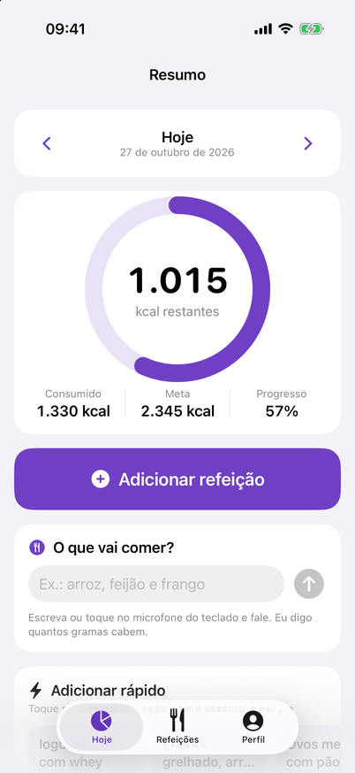
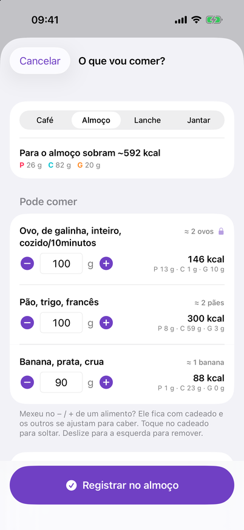
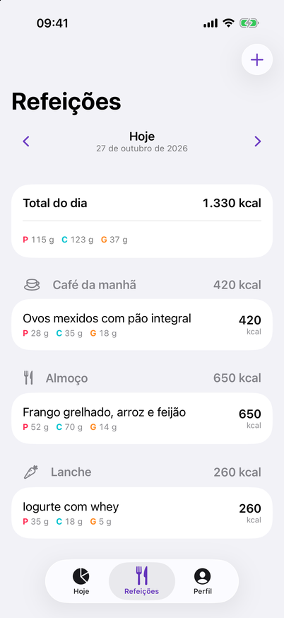
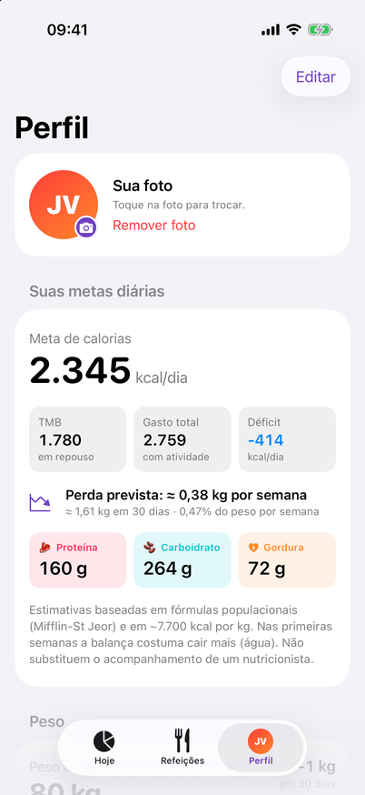
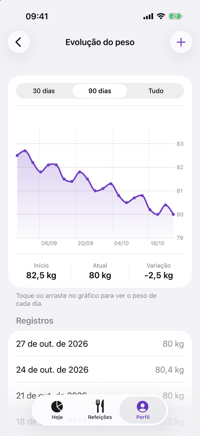
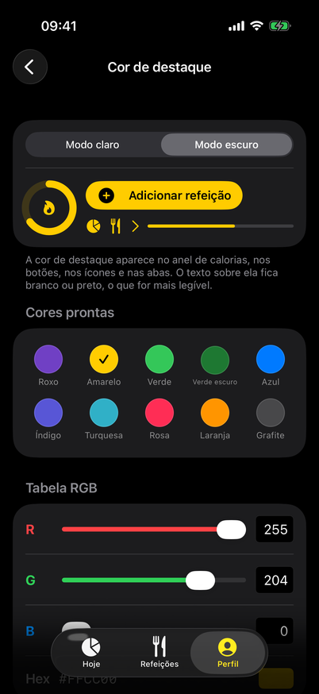
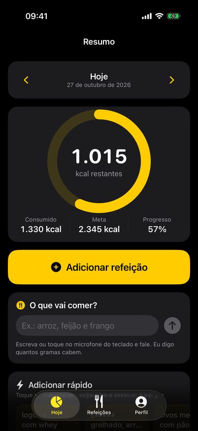

# MacroFit

App iOS pessoal para **recomposição corporal**: calcula sua meta diária de calorias e de proteína,
carboidrato e gordura, e deixa você registrar as refeições do dia para ver quanto ainda falta.

- SwiftUI + SwiftData, iOS 17+, só iPhone
- Tudo fica salvo no aparelho: sem login, sem servidor, sem bibliotecas externas

> As metas são estimativas por fórmulas populacionais e **não substituem um nutricionista**.

<p align="center">
  
  
  
  
</p>
<p align="center">
  
  
  
</p>

<sub>Capturas do modo demonstração (dados de exemplo).</sub>

## Telas

| Aba | O que tem |
|---|---|
| **Hoje** | Anel de calorias (consumido / meta / quanto falta), botão grande **+ Adicionar refeição**, **Adicionar rápido** (suas refeições frequentes com um toque; segure para escolher a porção), **dica do momento**, barras de proteína, carbo e gordura e resumo por tipo de refeição |
| **Refeições** | Refeições do dia agrupadas por tipo. Deslize para a esquerda para **editar** ou **apagar**; toque para editar |
| **Perfil** | TMB, gasto total, meta, déficit/superávit e macros; **peso** com mini gráfico, **Registrar peso** e **Ver evolução** (gráfico com 30/90 dias/tudo: toque ou arraste para ver cada dia); seus dados com botão **Editar** |

### Registrar uma refeição (por alimentos)
1. Toque em **Adicionar refeição**. O modo **Por alimentos** já vem selecionado.
2. Escreva o que comeu no campo do topo, por exemplo **"200g de arroz e 150g de carne"**, ou toque no
   🎤 do teclado e **fale**. Também dá para usar **Adicionar alimento** e buscar na tabela.
3. Ajuste os gramas (−10/+10). Calorias e macros de cada alimento e o total são calculados na hora.
4. **Quanto posso comer?** mostra quanto sobra para esta refeição. **Sugerir quantidades** ajusta os gramas
   de cada alimento para caber nisso, sem passar das calorias.

Os valores vêm da **TACO** (Tabela Brasileira de Composição de Alimentos, 4ª ed., NEPA/UNICAMP, 2011), com 591
alimentos por 100 g, inclusive pratos como arroz carreteiro, feijoada e estrogonofe. Funciona sem internet.
O que não estiver na tabela (whey, produtos de marca, leite integral, que está "em reanálise" na TACO) você
cadastra em **Cadastrar alimento pelo rótulo**. Para produtos de rótulo também existe o modo **Digitar valores**.

Use as setas ‹ › no topo de Hoje ou Refeições para trocar de dia, ou toque na data para abrir o calendário.
O dia escolhido vale para as duas abas. Ao adicionar uma refeição, toque em **Repetir refeição anterior**
para reaproveitar algo que você já registrou. Escolha a porção (½×, 1×, 1½×, 2×) para ajustar os valores.

Outras interações:
- **Tela de carregamento** animada ao abrir o app.
- **Comemoração:** ao bater a meta de proteína, ou levar as calorias para a faixa da meta (95–105%), aparecem um
  aviso e um confete, com vibração. Só no momento em que acontece, não ao reabrir o app.
- **Desfazer:** toda adição rápida mostra um aviso com "Desfazer" por 4 segundos.
- **Peso → metas:** as metas usam o peso mais recente registrado. Ao registrar um peso novo, o app mostra como cada
  meta mudou.

## Pré-requisitos

1. **Xcode 16 ou mais novo** (testado no Xcode 26.6), instalado pela App Store.
2. **Plataforma iOS do Xcode**, que inclui o simulador. Se o Xcode reclamar que "iOS xx is not installed":
   ```sh
   xcodebuild -downloadPlatform iOS
   ```
   Ou pelo Xcode: **Settings › Components**.
3. **XcodeGen**, que gera o `MacroFit.xcodeproj` a partir do `project.yml`:
   ```sh
   brew install xcodegen            # se você usa Homebrew
   ```
   Sem Homebrew, baixe o `xcodegen.zip` em <https://github.com/yonaskolb/XcodeGen/releases>,
   descompacte e rode `./install.sh ~/.local`. O binário vai para `~/.local/bin`, que precisa estar no seu `PATH`.

## Abrir no Xcode

```sh
cd ~/MacroFit
xcodegen generate        # cria o MacroFit.xcodeproj (ele não fica no git)
open MacroFit.xcodeproj
```

Rode `xcodegen generate` de novo sempre que **adicionar ou remover arquivos** ou mudar o `project.yml`.

### No simulador

No topo do Xcode, escolha um simulador de iPhone (ex.: *iPhone 17*) e aperte **⌘R**.

### Testes

São 144 testes: 120 unitários (calculadora, validação, refeições, porções, peso, comemoração, dicas, tabela de
alimentos, sugestão de gramas e leitura de texto) e 24 de interface, que tocam na tela do simulador (onboarding, refeições, tela Hoje, adicionar rápido com Desfazer e porção,
registro de peso, comemoração e dica).

**⌘U** no Xcode, ou pelo terminal:

```sh
xcrun simctl bootstatus "iPhone 17" -b      # liga o simulador e espera ficar pronto
xcodebuild test -project MacroFit.xcodeproj -scheme MacroFit \
  -destination 'platform=iOS Simulator,name=iPhone 17'
```

Para rodar só os unitários (menos de 1 segundo), acrescente `-only-testing:MacroFitTests`.
Troque o nome do simulador por um dos que aparecem em `xcrun simctl list devices available`.

> Se o primeiro `xcodebuild test` falhar com *"Application failed preflight checks"*, foi porque o simulador
> ainda estava ligando. É só rodar de novo (ou rodar o `bootstatus` acima antes).

## Rodar no seu iPhone com Apple ID gratuito

Não precisa pagar o Apple Developer Program (US$ 99/ano). Com uma conta gratuita o app funciona
normalmente, só que a assinatura **vale por 7 dias**. Depois disso o app para de abrir e basta
rodar de novo pelo Xcode; os dados salvos continuam no iPhone.

### 1. Adicione seu Apple ID ao Xcode (só uma vez)
**Xcode › Settings… › Accounts › +** › *Apple ID* e faça login.
Vai aparecer um time chamado **"Seu Nome (Personal Team)"**.

### 2. Configure o Signing
O Team ID fica num arquivo local, fora do git (cada pessoa tem o seu):
```sh
cp Config/Signing.local.example.xcconfig Config/Signing.local.xcconfig
```
Abra `Config/Signing.local.xcconfig` e troque `ABCDE12345` pelo seu Team ID
(**Xcode › Settings › Accounts** › seu Apple ID › *Personal Team*; ou escolha o time em
**Signing & Capabilities** e copie o valor de `DEVELOPMENT_TEAM` em *Build Settings*). Depois rode `xcodegen generate`.

Se aparecer um erro de que o **Bundle Identifier** já está em uso, troque `com.joaovitor.macrofit`
por algo único, como `com.seunome.macrofit`, no `PRODUCT_BUNDLE_IDENTIFIER` do `project.yml`.

### 3. Prepare o iPhone (só uma vez)
1. Conecte o iPhone no Mac por cabo e toque em **Confiar** no aviso do iPhone.
2. Ative o **Modo de Desenvolvedor**: **Ajustes › Privacidade e Segurança › Modo de Desenvolvedor**,
   ligue e reinicie o iPhone. A opção só aparece depois que o iPhone foi conectado ao Xcode uma vez.

### 4. Rode
1. No topo do Xcode, escolha o seu iPhone como destino.
2. Aperte **⌘R**.
3. Na primeira vez, o iPhone vai bloquear o app como "desenvolvedor não confiável". Para liberar:
   **Ajustes › Geral › VPN e Gerenciamento de Dispositivos** › seu Apple ID › **Confiar**.
4. Abra o MacroFit no iPhone.

Depois da primeira vez, dá para rodar sem cabo: no Xcode, **Window › Devices and Simulators**,
selecione o iPhone e marque **Connect via network**. O iPhone e o Mac precisam estar na mesma rede Wi-Fi.

## Estrutura

```
MacroFit/
├── MacroFitApp.swift      # entrada do app e container do SwiftData
├── Models/                # UserProfile, Meal e WeightEntry (@Model), enums, Macros, Portion
├── Services/              # NutritionCalculator (fórmulas), DailyCoach (comemoração e dicas), WeightLog, validação
├── ViewModels/            # estado dos formulários, dia selecionado, resumo do dia
└── Views/                 # Splash, Onboarding, Today, Meals, Profile, Weight, Components
MacroFitTests/             # XCTest: calculadora, validação, refeições
MacroFitUITests/           # XCUITest: fluxos na tela (usam dados de demonstração em memória)
```

As fórmulas estão documentadas no `CLAUDE.md` e em `Services/NutritionCalculator.swift`.
A tabela de alimentos é gerada por `Tools/taco/generate_taco.py`; veja `Tools/taco/README.md`.
